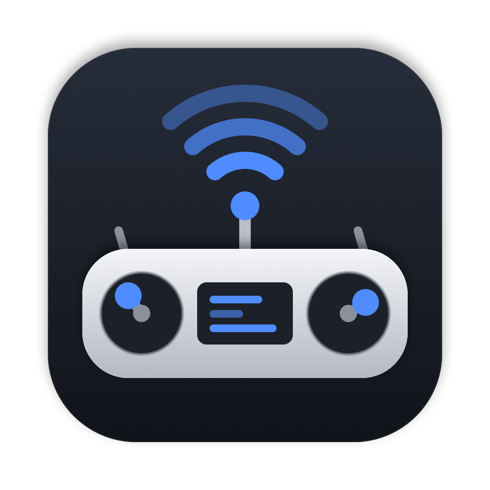
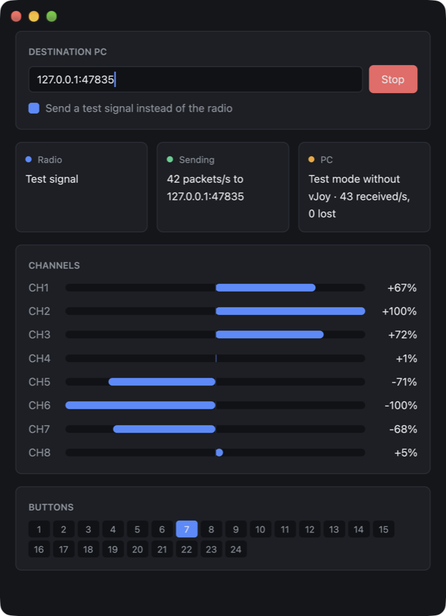

<p align="center">
  
</p>

<h1 align="center">TX16S Bridge</h1>

<p align="center">
  Fly PC drone simulators from your Mac, over game streaming, with your real RC radio.
</p>

---

## Why

You play on a Mac, but the game runs on a Windows PC and is streamed to the Mac with
Steam Remote Play, Moonlight/Sunshine or similar. Gamepads usually follow the stream.
An RC transmitter used as a USB joystick does not: the streaming client only forwards
devices it recognizes as gamepads, so FPV simulators on the PC never see your radio.

TX16S Bridge sends the radio to the PC on its own path. It reads the transmitter over
USB on the Mac and streams its sticks and switches over the local network. On the PC, a
Windows service feeds them into a [vJoy](https://github.com/BrunnerInnovation/vJoy)
virtual joystick, which games see as a local controller. It works with any streaming
software, because it does not go through it.

```
 RC radio ──USB──▶ Mac: TX16S Bridge.app ──UDP──▶ PC: tx16s-receiver service ──▶ vJoy ──▶ game
                        ▲                                    │
                        └──────── status (vJoy, packet loss) ┘
```

<p align="center">
  
</p>

## Features

- **Mac app** (Rust + [gpui](https://gpui.rs)): live view of the 8 channels and 24
  buttons, link status on both ends, a test signal to check the PC without the radio.
- **Menu bar item**: shows at a glance whether the link is healthy and keeps streaming
  with the window closed.
- **Windows service**: starts with Windows, needs no session open, reports vJoy problems
  back to the Mac, and retries until vJoy is ready.
- **Failsafe**: if the PC hears nothing for 500 ms, it centers the axes and releases the
  buttons instead of freezing the last input.
- **Low latency**: every USB report from the radio is forwarded immediately (around 500
  packets per second with a TX16S), with a keepalive when the radio is idle.

## Requirements

| Side | Needs |
|---|---|
| Radio | EdgeTX radio in **USB Joystick** mode, classic layout (8 axes, 24 buttons). Developed with a RadioMaster TX16S MK3; other EdgeTX radios with the same layout should work but are untested. |
| Mac | macOS 12 or later. Building needs Rust and full Xcode with its Metal toolchain. |
| PC | Windows 10 or 11, [vJoy](https://github.com/BrunnerInnovation/vJoy), Rust with the Visual Studio Build Tools. |
| Network | Both machines on the same local network. Ethernet on the Mac is best, Wi-Fi works. |

## Installation

### 1. Windows PC

1. Install vJoy. In **Configure vJoy**, enable device 1 with 8 axes and 32 buttons.
2. Install Rust from [rustup.rs](https://rustup.rs) (accept the Visual Studio Build
   Tools it offers), then build the receiver:
   ```
   cargo build --release -p tx16s-receiver
   ```
3. From an **administrator** terminal, install and start the service:
   ```
   target\release\tx16s-receiver.exe install
   ```
   This copies the program to `C:\Program Files\tx16s-bridge\`, registers the
   `tx16s-receiver` service (automatic start) and adds a Windows Firewall rule for the
   **Private** network profile. Make sure your network is set to Private.

### 2. Mac

```sh
./scripts/bundle-macos.sh
cp -R "target/release/TX16S Bridge.app" /Applications/
```

The script uses `/Applications/Xcode.app` when `xcode-select` points to the Command
Line Tools. If the Metal compiler is missing, install it once with
`xcodebuild -downloadComponent MetalToolchain`.

### 3. First run

1. Plug the radio into the Mac and choose **USB Joystick** on its screen.
2. Open **TX16S Bridge**. macOS asks for **Input Monitoring** permission the first time,
   which is needed to read the radio.
3. Enter the PC's address (`192.168.1.20`, or `192.168.1.20:47800` for a custom port)
   and click **Start**. The address and the started/stopped state are remembered.
4. The **PC** card should turn green with **vJoy ready**. In the simulator, bind the
   axes and switches to the vJoy device and calibrate once.

## Usage

**Mac app.** Closing the window keeps streaming, and the app stays in the menu bar.
Reopen it from the menu bar item or the Dock. `⌘W` closes the window, `⌘Q` quits.
Launching with `--test`, or ticking the test signal box, replaces the radio with slow
sine waves.

**Windows service.**

| Command | Effect |
|---|---|
| `tx16s-receiver status` | Show the service state |
| `tx16s-receiver stop` / `start` | Stop or start the service |
| `tx16s-receiver uninstall` | Remove the service and its firewall rule |
| `tx16s-receiver run` | Run in the terminal instead of as a service |
| `tx16s-receiver run --dry-run` | Run without vJoy, on any OS, to test the network |

Configuration lives in `C:\ProgramData\tx16s-bridge\config.toml`; restart the service
after editing it.

```toml
port = 47800                      # UDP port the Mac sends to
device = 1                        # vJoy device number
timeout_ms = 500                  # silence before the failsafe centers everything
# allowed_sender = "192.168.1.10" # only accept packets from this Mac
# vjoy_dll = 'C:\Program Files\vJoy\x64\vJoyInterface.dll'
```

Logs are written to `C:\ProgramData\tx16s-bridge\logs\`, one file per day, kept 7 days.
They record connections, failsafe events and a per-minute packet loss summary.

## Streaming tips

- **Sunshine**: if no gamepad is used, uncheck **Enable Gamepad Input** (Configuration →
  Input). Otherwise its virtual Xbox controller can take priority over vJoy in some
  games.
- **Steam**: if a game misreads the radio, disable **Steam Input** for that game
  (Properties → Controller).
- **Moonlight on macOS**: if the PC is not found, allow Moonlight in System Settings →
  Privacy & Security → **Local Network**, or add the PC by IP address.

## Troubleshooting

| Message or symptom | Check |
|---|---|
| **Plug in the radio in USB Joystick mode** | Radio mode on its screen; Input Monitoring permission for the app. |
| **No answer from the PC** | Service running (`tx16s-receiver status`); network profile set to Private; same port on both sides. |
| **vJoy is not installed / is disabled / device unavailable** | vJoy installed, enabled, and device 1 configured. |
| Inputs drop for a moment | Look for `signal lost` lines in the service logs. If there are any, the network had gaps over 500 ms: prefer Ethernet, or raise `timeout_ms`. |

## How it works

| Path | Role |
|---|---|
| `crates/protocol` | Wire format shared by both programs |
| `crates/sender` | Mac app: HID reading, UDP streaming, gpui window, menu bar item |
| `crates/receiver` | Windows service: UDP receiving, failsafe, vJoy output, status replies |
| `python/` | The original prototype scripts, compatible with the same protocol |
| `scripts/` | Mac app bundling and icon generation |

The Mac reads the radio's raw HID reports with `hidapi`. SDL-based input layers do not
list it as a joystick on macOS. Each report becomes a 28-byte UDP packet: magic,
sequence number, button bitmask and 8 signed 16-bit axes. The receiver drops
out-of-order packets, counts the missing ones, and answers about once per second with
a 16-byte status packet: vJoy state, packets per second, packets lost.

## Development

```sh
cargo test --workspace
cargo clippy --workspace --all-targets -- -D warnings
cargo check -p tx16s-receiver --target x86_64-pc-windows-gnu   # Windows code, from a Mac
```

gpui compiles its Metal shaders at build time, so building the Mac app needs full
Xcode. If `xcode-select` points to the Command Line Tools, prefix cargo with
`DEVELOPER_DIR=/Applications/Xcode.app/Contents/Developer`.
`scripts/bundle-macos.sh` does this for you.

The icon is drawn by `scripts/make-icon.swift`, which regenerates
`assets/AppIcon.icns` and `assets/AppIcon.png`.

`scripts/package-windows.sh` builds `dist/tx16s-bridge-windows.zip`: the receiver's
sources only, to build on a PC without cloning the whole repository.

## License

[MIT](LICENSE). The text field in the Mac app is adapted from gpui's `input` example,
licensed under Apache-2.0.

TX16S, RadioMaster, EdgeTX, Steam, Moonlight and Sunshine are mentioned only to describe
compatibility. This project is not affiliated with any of them.
